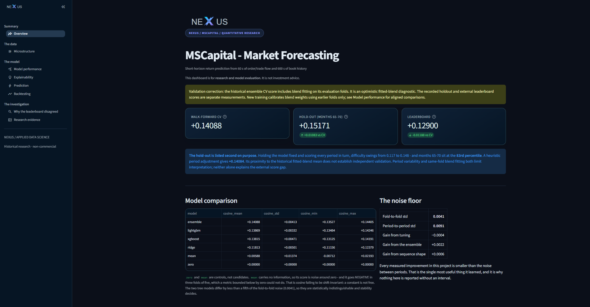
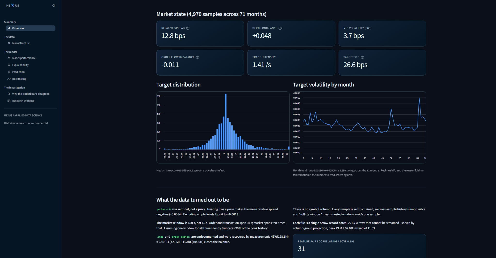
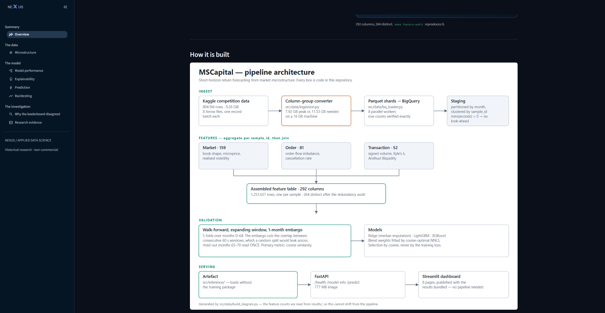

# NEXUS · MSCapital Market Forecasting

<p align="right"></p>

[](https://ms-capital-market-forecasting-mfy6rngulq4fpaovzrhntf.streamlit.app/)
[](https://github.com/senanurcetin/ms-capital-market-forecasting/actions/workflows/ci.yml)
[](https://www.python.org/downloads/release/python-3110/)
[](LICENSE)
[](https://docs.astral.sh/ruff/)

An end-to-end ML system that predicts short-horizon returns from market microstructure
data — **804.5M raw rows** reduced to a scored model on a 16 GB laptop, built on the Kaggle
[MSCapital](https://www.kaggle.com/competitions/ms-capital-real-financial-market-forecasting)
competition dataset.

`BigQuery` · `LightGBM` · `XGBoost` · `scikit-learn` · `SHAP` · `Optuna` · `Pandera` ·
`MLflow` · `FastAPI` · `Streamlit` · `Docker` · `GitHub Actions`

## Headline result

| | cosine | what it is |
|---|---:|---|
| Walk-forward CV mean | **+0.14088** | historical fitted-blend diagnostic, averaged over 5 periods |
| Hold-out, months 65–70 | +0.15171 | measured once, untouched — but a *lucky* period |
| Leaderboard, first submission | +0.12800 | single LightGBM, months 0–63 |
| **Leaderboard, shipped model** | **+0.12900** | ensemble, months 0–67 |

The source training table contains 1,257,637 samples and 292 features; only **264 features
are actually distinct** ([feature redundancy](docs/RESEARCH.md#feature-redundancy)). On the
hold-out, Pearson (0.15236) is almost identical to cosine, so predictions are centred on
zero — what a shift-sensitive metric rewards. Directional accuracy 0.5516, RMSE 0.003364.

**Why the hold-out is listed second.** It was the original headline and was never touched by
feature design, model selection, tuning or early stopping. But holding a model fixed and
scoring it on every period shows difficulty swinging from 0.117 to 0.148, and months 65–70
sit at the **83rd percentile**. A heuristic period adjustment gives +0.14084; its closeness
to the fitted-blend mean (+0.14088) does not establish independent validation, because the
blend was fitted on its scored folds.

A separate [full-data fixed-fit revalidation](docs/REVALIDATION.md) on the same four
periods scores **+0.138046** for fixed-budget LightGBM and **+0.138299** for the
prior-fold calibrated blend.

## Demo

**▶ [Open the Streamlit dashboard](https://ms-capital-market-forecasting-mfy6rngulq4fpaovzrhntf.streamlit.app/)** — eight research pages, including source provenance and a downloadable evidence report.

These **three genuine Streamlit application screenshots** were provided directly by
the project owner on **6 November 2026**. They replace the old source-rendered
placeholder. The visible data describes historical research, not live market
trading or an independently audited deployment commit.

**Overview — research metrics and model comparison**



**Market state — feature-sample distribution and monthly volatility**



**Pipeline — architecture displayed inside the Streamlit app**



- [Portfolio case study](https://senanur-cetin.vercel.app/projects/mscapital-market-forecasting) · [dashboard capture notes](docs/DASHBOARD_EVIDENCE.md)
- Model on Hugging Face: [senanurcetin/ms-capital-market-forecasting](https://huggingface.co/senanurcetin/ms-capital-market-forecasting) — the v4 ensemble, the model card and every result file
- Latest release: [v1.1.0](https://github.com/senanurcetin/ms-capital-market-forecasting/releases/tag/v1.1.0)
- Kaggle notebooks: [My Hold-out Was a Lucky Stretch](https://www.kaggle.com/code/senanuretin/ms-capital-my-hold-out-was-a-lucky-stretch) (period difficulty and walk-forward analysis) · [Four Experiments That Did Not Help](https://www.kaggle.com/code/senanuretin/ms-capital-four-experiments-that-did-not-help)

## Quick start

```bash
python -m pip install -r requirements-dev.txt
python -m src.evaluation.evidence
python -m src.evaluation.uncertainty
python -m streamlit run streamlit_app/app.py
```

The dashboard runs from committed results and needs no cloud credentials. Training writes a
`.run.json` sidecar with input/output hashes, selected rows, model parameters and code
revision. See [reproducibility](docs/REPRODUCIBILITY.md), [experiment operations](docs/OPERATIONS.md)
and [Kaggle / BigQuery integration](docs/INTEGRATIONS.md).

## Details

**Documentation:** [start here](docs/README.md) · [validation protocol](docs/VALIDATION.md) ·
[revalidation](docs/REVALIDATION.md) · [model card](MODEL_CARD.md) ·
[verification record](docs/VERIFICATION.md) · [brand identity](docs/BRAND_IDENTITY.md).
Every figure in the model card is checked against `results/` by a test.

### What I found

The source has 804.5M market/order/trade rows with different observation windows,
empty-book sentinels, truncated event histories and 292 engineered columns (264 distinct).
[Notebook 01](notebooks/01_data_discovery.ipynb) covers the six data findings that drive the
pipeline; [notebook 05](notebooks/05_why_the_leaderboard_disagreed.ipynb) tests six
hypotheses for the leaderboard gap — one confirmed, one real but smaller than forecast, four
falsified. The full findings and failed hypotheses are in
[the research narrative](docs/RESEARCH.md).

### Validation

Base models are evaluated on five chronological periods with a one-month embargo. New runs
fit ensemble blend weights only on earlier out-of-fold predictions and omit the first fold
from ensemble scoring. The uncertainty report aligns model periods and excludes the
historical blend. [Validation protocol](docs/VALIDATION.md).

### Architecture

Kaggle Feather files → Arrow/Parquet projections → BigQuery staging/features → local model
training → derived results → NEXUS Streamlit and self-contained HTML reports.
[Architecture diagram](docs/architecture.svg).

The [warehouse audit](results/warehouse_audit.json) covers 22 tables, nine metadata
contracts and 292 model features compatible with both assembled datasets, with schema
fingerprints and download dry runs. Logical storage is about 69.4 GiB.

Both Kaggle notebooks were re-executed after the validation correction; their runs and
source hashes are recorded in [publication readback](results/kaggle_publications.json).

## Limitations

- **Research only, not investment advice.** The backtesting module measures ranking power; it does not propose a strategy, and no trading profitability is claimed.
- **The +0.14088 CV mean is optimistic.** The historical ensemble fitted and scored its blend weights on the same folds, so it is a fitted-blend diagnostic, not an unbiased estimate. Early stopping also uses each validation fold, so base-model scores are not nested outer-test estimates.
- **The hold-out is one lucky stretch** (83rd percentile of period difficulty); a single contiguous period underrepresents variation across periods.
- **The served model is not the leaderboard model.** The dashboard serves LightGBM v3; the v4 ensemble earned the +0.129 leaderboard score. See the [model card](MODEL_CARD.md).
- **Scores are historical.** The revalidation is retrospective: no hold-out remeasurement, no model promotion, no new competition score.
- **The three screenshots are owner-supplied Streamlit interface captures (6 November 2026)**, not AI-generated imagery or a live-market feed. They do not certify the exact deployed commit, ongoing availability, or newly validated model scores.
- **Cloud rebuilds cost money.** The client caps individual queries, full feature downloads exceed the default query ceiling, and a zero monthly bill is not guaranteed. [Cost boundaries](docs/INTEGRATIONS.md#cost-boundaries).

## Licence

[MIT](LICENSE) covers software. Competition data remains subject to Kaggle rules.
[Notices](NOTICE.md) · [Contributing](CONTRIBUTING.md) · [Security](SECURITY.md).
