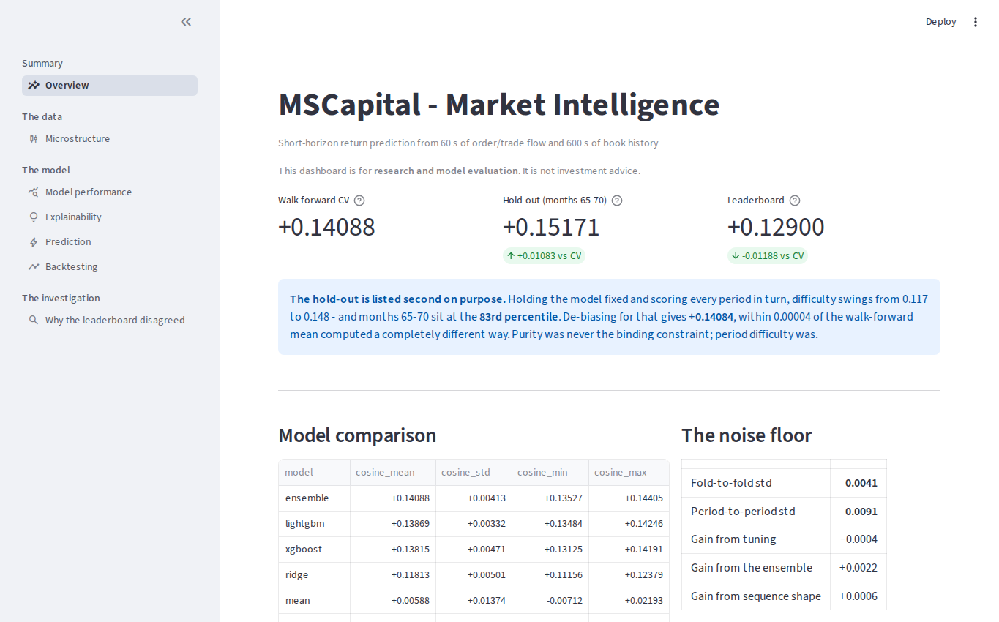

# NEXUS · MSCapital Market Forecasting

> **Validation correction (20 October 2026):** the historical ensemble CV fitted and scored blend weights on the same fold. Its +0.14088 is an optimistic fitted-blend diagnostic, not an unbiased external-performance estimate. New training calibrates weights on earlier folds only. Historical results are retained; no full-data rerun is claimed.


<p align="right"></p>

**Documentation:** [Start here](docs/README.md) · [Reproduce](docs/REPRODUCIBILITY.md) · [Kaggle / BigQuery](docs/INTEGRATIONS.md) · [Brand identity](docs/BRAND_IDENTITY.md).

**Technical reviewer brief:** [Problem, quantitative evidence and limitations](docs/hiring-summary.md).



> **Source-rendered Streamlit capture (12 October 2026), not a live-market feed.** This screenshot documents the research UI from source; it is not independent proof that the currently deployed app matches the image or that all current pages render. [Dashboard evidence, model-version boundaries and recapture checks](docs/DASHBOARD_EVIDENCE.md).

[](https://ms-capital-market-forecasting-mfy6rngulq4fpaovzrhntf.streamlit.app/)
[](https://github.com/senanurcetin/ms-capital-market-forecasting/actions/workflows/ci.yml)
[](https://www.python.org/downloads/release/python-3110/)
[](LICENSE)
[](https://docs.astral.sh/ruff/)

An end-to-end, production-shaped ML system that predicts short-horizon returns from market
microstructure data — **804.5M raw rows** reduced to a scored model, on a 16 GB laptop.
Built on the Kaggle
[MSCapital](https://www.kaggle.com/competitions/ms-capital-real-financial-market-forecasting)
competition dataset.

**▶ [Open the published Streamlit dashboard](https://ms-capital-market-forecasting-mfy6rngulq4fpaovzrhntf.streamlit.app/)** — eight research pages, including source provenance and a downloadable evidence report. [Portfolio case study](https://senanur-cetin.vercel.app/projects/mscapital-market-forecasting) · [Dashboard screenshot review status](docs/DASHBOARD_EVIDENCE.md).

**Kaggle notebook:** [MS Capital: My Hold-out Was a Lucky Stretch](https://www.kaggle.com/code/senanuretin/ms-capital-my-hold-out-was-a-lucky-stretch) — the period-difficulty and walk-forward analysis behind the headline result, runnable on Kaggle.

**Model on Hugging Face:** [senanurcetin/ms-capital-market-forecasting](https://huggingface.co/senanurcetin/ms-capital-market-forecasting) —
the v4 ensemble, the model card and every result file. **Latest release:**
[v1.1.0](https://github.com/senanurcetin/ms-capital-market-forecasting/releases/tag/v1.1.0).
**Kaggle notebook (what the later experiments found):**
[MS Capital: Four Experiments That Did Not Help](https://www.kaggle.com/code/senanuretin/ms-capital-four-experiments-that-did-not-help).
The page worth opening first is *Why the leaderboard disagreed*.

`BigQuery` · `LightGBM` · `XGBoost` · `scikit-learn` · `SHAP` · `Optuna` · `Pandera` ·
`MLflow` · `FastAPI` · `Streamlit` · `Docker` · `GitHub Actions`

**Research status: historical study with validation corrections.** Five executed notebooks, two scored submissions, and
a test suite that injects the failures it claims to prevent. Follow-up maintenance and test
corrections can still occur; the documented historical scores do not change without new
evaluation evidence. Research limitations remain explicit in [Where this stands](#where-this-stands).

**Where to start**, depending on how long you have:

| | |
|---|---|
| **2 minutes** | [Headline result](#headline-result) — the scores, and the forecast that was wrong |
| **20 minutes** | ↑ plus [What I found](#what-i-found) and [notebook 01](notebooks/01_data_discovery.ipynb) — the six data findings that drive everything |
| **an hour** | ↑ plus [notebook 05](notebooks/05_why_the_leaderboard_disagreed.ipynb) — six hypotheses — one confirmed, one real but smaller than forecast, four falsified — and two errors caught in my own analysis |

**Model-version boundary:** the [model card](MODEL_CARD.md) identifies the **default served inference model as LightGBM v3**; the separately submitted **v4 ensemble** earned the external +0.129 leaderboard score. Do not treat the dashboard prediction UI as a deployed v4 ensemble. [Full interface evidence guide](docs/DASHBOARD_EVIDENCE.md).

**Model card:** [`MODEL_CARD.md`](MODEL_CARD.md) - what the model is, what it is for, the numbers, and the limits, every figure checked against `results/` by a test.

> **For research only. Not investment advice.**
> The backtesting module exists to measure the model's ranking power, not to propose a strategy.

---

## Headline result

| | cosine | what it is |
|---|---:|---|
| Walk-forward CV mean | **+0.14088** | **historical fitted-blend diagnostic** — averaged over 5 periods |
| Hold-out, months 65–70 | +0.15171 | measured once, untouched — but a *lucky* period |
| Leaderboard, first submission | +0.12800 | single LightGBM, months 0–63 |
| **Leaderboard, shipped model** | **+0.12900** | ensemble, months 0–67 |

Trained on all 1,257,637 samples and 292 features — though only **264 are actually distinct**; see [Feature redundancy](#feature-redundancy). On the hold-out, Pearson (0.15236) is
almost identical to cosine, confirming predictions are centred on zero — what a
shift-sensitive metric rewards. Directional accuracy 0.5516, RMSE 0.003364.

**The hold-out is listed second on purpose.** It was the original headline: measured once,
on months never touched by feature design, model selection, tuning or early stopping. That
is all true, and it is not the right number. Holding a model fixed and scoring it on every
period in turn shows difficulty swinging from 0.117 to 0.148 — and months 65–70 sit at the
**83rd percentile**. De-biasing for that gives +0.14084; the walk-forward mean, computed a
completely different way, gives +0.14088. Purity was never the binding constraint: a single
contiguous stretch is a sample of size one in the dimension that actually varies.

## What I found

The source contains 804.5M market/order/trade rows, with different observation windows,
empty-book sentinels, truncated event histories and 292 engineered columns (264 distinct).
The complete findings, failed hypotheses and executed notebook evidence are retained in
[the historical research narrative](docs/RESEARCH.md).

## Validation: walk-forward with an embargo

Base-model evaluation uses five chronological periods and a one-month embargo. Early
stopping uses each validation fold, so these are not nested outer-test estimates.
The historical ensemble also fitted its weights on its scored folds. New runs fit blend
weights only on earlier out-of-fold predictions and omit the first fold from ensemble
scoring. The uncertainty report aligns model periods and excludes the historical blend.
[Validation protocol and limitations](docs/VALIDATION.md).

## Architecture

Kaggle Feather files → Arrow/Parquet projections → BigQuery staging/features → local
model training → derived results → NEXUS Streamlit and self-contained HTML reports.
The dashboard requires no cloud credentials. [Architecture diagram](docs/architecture.svg).

**Warehouse verified on 20 October 2026:** 22 tables, nine metadata contracts, and
292 model features compatible with both assembled datasets. The
[dated audit](results/warehouse_audit.json) includes schema fingerprints and download
dry runs. Existing logical storage is about 69.4 GiB; full feature downloads exceed
the default query ceiling. [Verification scope and cost boundaries](docs/INTEGRATIONS.md).

## Reproduce

```bash
python -m pip install -r requirements-dev.txt
python -m src.evaluation.evidence
python -m src.evaluation.uncertainty
python -m streamlit run streamlit_app/app.py
```

See [reproducibility](docs/REPRODUCIBILITY.md), [experiment operations](docs/OPERATIONS.md)
and [Kaggle / BigQuery integration](docs/INTEGRATIONS.md). Training now creates a `.run.json`
sidecar containing input/output hashes, selected rows, model parameters and code revision.

## Where this stands

This is a non-commercial, English-first research portfolio. Competition scores remain
historical; no new score, trading profitability or full-data rerun is claimed. The served
LightGBM v3 and the separately submitted v4 ensemble have distinct evaluation scopes.
See the [model card](MODEL_CARD.md) and [verification record](docs/VERIFICATION.md).

## Cost

Viewing uses committed results. Cloud rebuilds need separate account/storage budget
controls; the client caps individual queries but cannot guarantee a zero monthly bill.
[Cost boundaries](docs/INTEGRATIONS.md#cost-boundaries).

## Licence

[MIT](LICENSE) covers software. Competition data remains subject to Kaggle rules.
[Notices](NOTICE.md) · [Contributing](CONTRIBUTING.md) · [Security](SECURITY.md).
